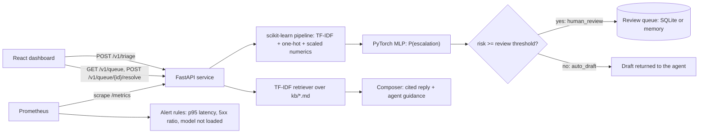

# OpsPilot AI

Escalation-risk triage for customer-support tickets. A FastAPI model-inference service
scores each ticket with a PyTorch classifier, drafts a reply that cites the internal
runbooks it relies on, and routes high-risk cases to a human-review queue. A React
dashboard drives the whole flow.

- **Predicts escalation risk** with a scikit-learn feature pipeline (TF-IDF text features
  plus encoded and scaled ticket fields) feeding a small PyTorch MLP. Held-out test F1 is
  **0.879** on synthetic data (see [Model results](#model-results)).
- **Drafts cited guidance** offline: TF-IDF retrieval over 10 markdown runbooks, then a
  templated reply quoting the most relevant sentences with `[1]`, `[2]` citations and a
  sources list. Internal policies become cited notes for the agent.
- **Routes high-risk cases to human review**: risk at or above a configurable threshold
  goes to a review queue (SQLite or in-memory behind a repository interface); everything
  else is auto-drafted.
- **Kept shippable**: 14 pytest unit, integration and failure-path tests (96% coverage),
  GitHub Actions quality gates, Docker images, Prometheus metrics and latency alerts.

> All tickets, labels and metrics here come from a seeded **synthetic** data generator.
> No real customer data is involved, and the scores say nothing about real-world accuracy.

## Contents

- [Architecture](#architecture)
- [Model results](#model-results)
- [Quickstart](#quickstart)
- [Configuration & secrets](#configuration--secrets)
- [API reference](#api-reference)
- [Testing](#testing)
- [Monitoring & alerts](#monitoring--alerts)
- [CI quality gates](#ci-quality-gates)
- [Project structure](#project-structure)
- [Limitations](#limitations)

## Architecture



Request flow for `POST /v1/triage`:

1. Validate the ticket (Pydantic; unknown fields, empty or oversized text are rejected).
2. Score it: feature pipeline, then the MLP forward pass (CPU, about 5 to 10 ms).
3. Route it: `risk_score >= review_threshold` means `human_review` and band `high`;
   below that the band is `medium` or `low` and the route is `auto_draft`.
4. Retrieve the top runbook passages; human-review cases always get an internal
   escalation-policy passage too.
5. Compose the draft (offline template by default) and attach rule-based signals
   (SLA breach, repeat contacts, cancellation or legal language, and so on).
6. Queue human-review cases, record Prometheus metrics, return everything with citations.

Training (`python -m opspilot.train`) generates 20,000 seeded tickets, makes a stratified
70/15/15 split, fits the feature pipeline on the training split only, trains the MLP with
early stopping on validation loss, tunes the F1-optimal threshold on validation, and
reports held-out test metrics.

## Model results

Real output of `python -m opspilot.train` (seed 42, CPU, about 10 s of training). The
threshold was tuned on the validation split; the test split was not used for any choice.

| Model (synthetic data, test split, n = 3,000) | F1 | Precision | Recall | ROC-AUC |
|---|---:|---:|---:|---:|
| **PyTorch MLP** (threshold 0.40) | **0.879** | 0.864 | 0.894 | 0.968 |
| Logistic regression, same features (baseline) | 0.861 | 0.842 | 0.882 | 0.963 |
| Oracle: generator's hidden noise-free probability | 0.922 | 0.917 | 0.928 | 0.975 |

- Validation F1 for the MLP is 0.859 (precision 0.884, recall 0.835); test F1 is 0.879
  (accuracy 0.935, PR-AUC 0.939). Gaps like this are normal sampling noise for
  3,000-ticket splits.
- Test confusion matrix: 703 true positives, 111 false positives, 83 false negatives,
  2,103 true negatives (positive rate 26%).
- The **oracle** row scores tickets with the generator's hidden escalation probability,
  which no model can see. It is the rough ceiling given the label noise, so the MLP sits
  between a linear baseline and what the data allows.
- Training is deterministic on CPU (weights hash `mlp-3857231974` here); other
  platforms can differ in the last decimals. Every run writes `artifacts/metrics.json`.

**How the synthetic task works.** Each ticket has two hidden variables, issue severity
and customer frustration, which drive repeat contacts, ticket age, impact phrases and the
tone of the text. The `escalated` label is a noisy function of those hidden variables and
of tier, product area, channel and SLA breach (with key-account interactions), and 2% of
labels are flipped at random. Observed features are informative but imperfect proxies, so
the task is learnable but not trivial. The generator's noise levels were set so the task
is neither trivial nor hopeless; the number above is whatever the held-out split gives.

## Quickstart

### Local (Python 3.12, Node 24)

```bash
# 1. API: virtual environment, CPU-only PyTorch, dependencies
python -m venv .venv && source .venv/bin/activate        # Windows: .venv\Scripts\activate
pip install torch==2.15.0 --index-url https://download.pytorch.org/whl/cpu
pip install -r requirements-dev.txt

# 2. Train (writes artifacts/ and artifacts/metrics.json), then serve on http://127.0.0.1:8000
python -m opspilot.train
python -m opspilot.api                                    # docs at http://127.0.0.1:8000/docs

# 3. Dashboard on http://localhost:5173
cd dashboard
cp .env.example .env                                      # sets VITE_API_URL
npm ci
npm run dev
```

Optional: `cp .env.example .env` in the repository root to override API settings. Every
value there is empty by default, so copying it changes nothing until you fill something in.

### Docker Compose

```bash
docker compose up --build
```

| Service | URL |
|---|---|
| Dashboard | http://localhost:8080 |
| API (OpenAPI docs at `/docs`) | http://localhost:8000 |
| Prometheus (rules under Alerts) | http://localhost:9090 |

The API image trains the model during `docker build`, so the stack needs no downloads at
runtime. The review queue and Prometheus data live in named volumes.

## Configuration & secrets

All configuration comes from environment variables, validated at startup by
pydantic-settings (`opspilot/config.py`). Locally they can also come from a git-ignored
`.env` (template: [`.env.example`](.env.example)); Docker Compose reads the same file
for `${VAR}` substitution. Every variable has a safe, non-secret default, so the service
runs without any configuration.

| Variable | Required | Secret | Default | Purpose |
|---|---|---|---|---|
| `OPSPILOT_ARTIFACTS_DIR` | no | no | `artifacts` | Trained model artifacts (`/app/artifacts` in the image) |
| `OPSPILOT_KB_DIR` | no | no | `kb` | Markdown runbooks used for citations |
| `OPSPILOT_QUEUE_BACKEND` | no | no | `sqlite` | Review queue backend: `sqlite` or `memory` |
| `OPSPILOT_QUEUE_DB_PATH` | no | no | `data/review_queue.db` | SQLite file for the review queue |
| `OPSPILOT_RISK_THRESHOLD` | no | no | tuned on validation (0.40) | Risk at or above this goes to human review |
| `OPSPILOT_MEDIUM_THRESHOLD` | no | no | 60% of the review threshold | Lower edge of the "medium" band |
| `OPSPILOT_RETRIEVAL_TOP_K` | no | no | `3` | Runbook passages retrieved per ticket (1 to 10) |
| `OPSPILOT_COMPOSER` | no | no | `template` | `template` (offline) or `llm` (optional hook) |
| `OPSPILOT_LLM_BASE_URL` | if composer is `llm` | no | none | OpenAI-compatible endpoint, e.g. `https://llm.example.com/v1` |
| `OPSPILOT_LLM_MODEL` | if composer is `llm` | no | none | Model name sent to that endpoint |
| `OPSPILOT_LLM_API_KEY` | if composer is `llm` | **yes** | none | Bearer key for the LLM endpoint |
| `OPSPILOT_LLM_TIMEOUT_SECONDS` | no | no | `15` | LLM call timeout before falling back to the template |
| `OPSPILOT_HOST` | no | no | `127.0.0.1` (`0.0.0.0` in the image) | Bind address of `python -m opspilot.api` |
| `OPSPILOT_PORT` | no | no | `8000` | Port of `python -m opspilot.api` |
| `OPSPILOT_LOG_LEVEL` | no | no | `info` | `critical`, `error`, `warning`, `info` or `debug` |
| `OPSPILOT_CORS_ORIGINS` | no | no | `http://localhost:5173,http://127.0.0.1:5173` (compose: `http://localhost:8080`) | Comma-separated browser origins allowed by CORS |
| `OPSPILOT_MAX_REQUEST_BYTES` | no | no | `1048576` | Larger declared request bodies get 413 |
| `OPSPILOT_TORCH_THREADS` | no | no | `1` | CPU threads for PyTorch inference |
| `API_PORT`, `DASHBOARD_PORT`, `PROMETHEUS_PORT` | no | no | `8000`, `8080`, `9090` | Host ports published by Compose |
| `VITE_API_URL` | yes, for the dashboard | no, public | none in code; `http://localhost:8000` in `.env.example`, Compose and the image build arg | API base URL the browser calls; set in `dashboard/.env` or as a build argument |

**How secrets are handled.**

- The project needs **no secrets** in its default configuration. The only secret it knows
  about is `OPSPILOT_LLM_API_KEY`, for the optional LLM composer, which is disabled
  unless `OPSPILOT_COMPOSER=llm`.
- That key is read only from the environment (or the git-ignored `.env`) and has no
  default. It is held as a `SecretStr`, so it is masked in logs and reprs, validation
  errors never echo input values, and the key is sent only in the `Authorization` header
  of LLM calls. If the hook is enabled without a key, base URL or model, startup fails
  with a message naming the missing variables.
- `.env` and `dashboard/.env` are git-ignored, and `.dockerignore` keeps them out of
  build contexts, so nothing secret is baked into an image. Compose passes the key only
  as `${OPSPILOT_LLM_API_KEY:-}`.
- `VITE_*` variables are compiled into the JavaScript bundle and are therefore public.
  Only the API URL is configured that way; never put a secret in a `VITE_*` variable.
- CI needs no secrets. Tests create ephemeral values in fixtures
  (`secrets.token_hex(16)`) and talk to a fake LLM transport, never a real provider.
- There is no secret-generation helper because the application owns no secrets; the LLM
  key is issued by the provider.

**Setting values.** Locally: export variables in your shell or fill in `.env` and
`dashboard/.env`. In production, inject them through your platform's environment and
secret manager (for example Kubernetes Secrets, AWS Secrets Manager, or
`${{ secrets.OPSPILOT_LLM_API_KEY }}` mapped to an environment variable in a deploy
workflow) rather than files. Before committing, scan tracked files with:

```bash
git grep -nIiE "(password|passwd|secret|api[_-]?key|token|BEGIN [A-Z ]*PRIVATE KEY|AKIA[0-9A-Z]{16})"
git ls-files | grep -E '(^|/)\.env'      # only the .env.example files should be listed
```

## API reference

Interactive OpenAPI docs are served at `/docs`.

| Method | Path | Description |
|---|---|---|
| `POST` | `/v1/triage` | Score one ticket, draft a cited reply, queue it for review when the risk is high |
| `POST` | `/v1/predict` | Batch scoring (1 to 100 tickets): score, band and route only, nothing is queued |
| `GET` | `/v1/model` | Model version, tuned and active thresholds, held-out test metrics |
| `GET` | `/v1/queue?status=pending\|resolved\|all&limit=50` | Review items (pending ones highest risk first) and the pending count |
| `POST` | `/v1/queue/{id}/resolve` | Body `{"resolution": "approved"\|"edited"\|"escalated"\|"dismissed", "reviewer"?, "note"?}` |
| `GET` | `/healthz` | Liveness: the process is up |
| `GET` | `/readyz` | Readiness: 200 when a model is loaded, otherwise 503 |
| `GET` | `/metrics` | Prometheus exposition format |

Ticket fields: `subject` (1 to 200 characters), `body` (1 to 5,000), `customer_tier`
(`free`, `pro`, `business`, `enterprise`), `product_area` (`billing`, `account_access`,
`integrations`, `data_export`, `performance`, `mobile_app`), `channel` (`email`, `chat`,
`web_form`, `phone`, `social`), `prior_contacts_30d` (default 0), `hours_open` (default
0) and an optional `ticket_id`.

```bash
curl -s -X POST http://127.0.0.1:8000/v1/triage -H "Content-Type: application/json" -d '{
  "ticket_id": "T-2001", "subject": "App not loading in Europe",
  "body": "The web app is not loading at all for our users in Europe. This is affecting all of our users. Nobody has replied to my previous emails. We are seriously considering cancelling our contract.",
  "customer_tier": "business", "product_area": "performance", "channel": "email",
  "prior_contacts_30d": 3, "hours_open": 11.0}'
```

Response (abridged from a real run):

```json
{
  "ticket_id": "T-2001",
  "risk_score": 0.9989,
  "risk_band": "high",
  "route": "human_review",
  "review_threshold": 0.4,
  "model_version": "mlp-3857231974",
  "signals": ["SLA breached: open 11.0h against the 8h Business window", "3 prior contacts in the last 30 days", "Key account (Business tier)", "Mentions cancelling, legal action or a payment dispute"],
  "draft": "Hi there,\n\nThank you for following up about \"App not loading in Europe\". ...\n- If the app is not loading for users in one region, the problem is handled as a possible incident under the outage communications process instead of as a single-account issue. [1]\n...\nSources:\n[1] Performance Troubleshooting - Region-wide problems\n[2] Incident and Outage Communications - Declaring an incident",
  "guidance": ["A ticket is escalated to a senior specialist when a Business or Enterprise ticket has breached its SLA window, ... [3]"],
  "citations": [
    {"ref": 1, "doc_id": "performance-troubleshooting", "title": "Performance Troubleshooting", "section": "Region-wide problems", "audience": "customer", "score": 0.2721, "excerpt": "..."},
    {"ref": 2, "doc_id": "outage-communications", "section": "Declaring an incident", "audience": "customer", "score": 0.1869, "...": "..."},
    {"ref": 3, "doc_id": "sla-escalation-policy", "section": "Mandatory escalation triggers", "audience": "internal", "score": 0.3039, "...": "..."}
  ],
  "composer": "template",
  "review_item_id": "rv_8011faed5c4a",
  "timings": {"inference_ms": 27.58, "drafting_ms": 7.52, "total_ms": 44.43}
}
```

Errors: `422` for invalid payloads (missing or unknown fields, bad enum values, empty or
oversized text, batches of 0 or more than 100), `413` when the declared body exceeds
`OPSPILOT_MAX_REQUEST_BYTES`, `503` from scoring endpoints while no model is loaded (the
queue endpoints keep working), `404` for an unknown review item and `409` when it is
already resolved.

## Testing

```bash
ruff check . && ruff format --check .
pytest --cov=opspilot --cov-fail-under=80      # 14 tests, about 7 s, 96% coverage
pytest -m unit          # or: -m integration, -m failure
```

A session fixture trains a tiny model (2,000 tickets) through the real training CLI, so
the suite stays fast while covering the save and load path. `OPSPILOT_*` variables are
cleared for every test, so local configuration never leaks in.

| Kind | Tests |
|---|---|
| Unit (8) | generator determinism and CLI; feature pipeline (SLA features, unseen categories); model artifact round-trip and metrics file; retrieval ranking; router threshold boundaries and configuration; cited template drafts; settings from env plus the optional LLM hook (fail-fast without a key, fake transport, fallbacks); both queue backends against one contract, including SQLite persistence |
| Integration (2) | `TestClient` end to end: low-risk ticket auto-drafted, high-risk ticket queued, then resolved (409 on a second resolve); batch predict, readiness, model info, CORS and the Prometheus histograms |
| Failure paths (4) | 422 for invalid payloads; 503 for scoring while no model is loaded; empty or oversized text (422) and oversized bodies (413); unknown queue id (404) |

## Monitoring & alerts

`GET /metrics` exposes, among others:

| Metric | Type | Labels |
|---|---|---|
| `opspilot_http_request_duration_seconds` | histogram | `method`, `route` (route template, e.g. `/v1/queue/{item_id}/resolve`) |
| `opspilot_http_requests_total` | counter | `method`, `route`, `status` |
| `opspilot_model_inference_seconds` | histogram | `endpoint` (`triage` or `predict`) |
| `opspilot_triage_decisions_total` | counter | `route`, `risk_band` |
| `opspilot_risk_score` | histogram | none (score distribution, useful for drift) |
| `opspilot_review_queue_pending`, `opspilot_model_loaded` | gauges | none |
| `opspilot_review_resolutions_total` | counter | `resolution` |
| `opspilot_model_info` | info | `version`, `review_threshold` |

[`prometheus/alerts.yml`](prometheus/alerts.yml) defines:

| Alert | Condition |
|---|---|
| `OpsPilotTriageLatencyP95High` | p95 of `POST /v1/triage` above 300 ms for 5 minutes |
| `OpsPilotHighErrorRate` | more than 5% of requests answered with 5xx for 5 minutes |
| `OpsPilotInferenceLatencyP95High` | p95 model inference above 100 ms for 10 minutes |
| `OpsPilotModelNotLoaded` | `opspilot_model_loaded == 0` for 2 minutes |
| `OpsPilotApiDown` | the scrape target is down for 1 minute |
| `OpsPilotReviewBacklogHigh` | more than 50 pending reviews for 30 minutes |

The latency histograms include a 0.3 s bucket, so the 300 ms threshold is exact rather
than interpolated. For reference, 300 sequential triage requests against a local API
(single worker, Windows laptop) measured p50 10.5 ms, p95 51.8 ms and p99 75.8 ms.

## CI quality gates

[`.github/workflows/ci.yml`](.github/workflows/ci.yml) runs on pushes to `main` and on
pull requests, with no secrets:

1. **python**: ruff lint and format check; train the model and fail if held-out test F1
   drops below 0.85; pytest with a coverage gate of 80%; upload `metrics.json`.
2. **dashboard**: `npm ci`, oxlint with warnings as errors, `tsc` type check, production build.
3. **monitoring**: `promtool check config`, which also validates the alert rules.
4. **docker** (after 1 and 2): validate `docker-compose.yml`, build both images without
   pushing, then start the API image and smoke-test `/readyz`, `/v1/triage` and `/metrics`.

## Project structure

```text
opspilot-ai/
├── opspilot/                  Python package
│   ├── config.py              Settings from OPSPILOT_* env vars (pydantic-settings)
│   ├── domain.py              Ticket vocabulary, SLA windows, escalation triggers
│   ├── data/generator.py      Seeded synthetic ticket generator (CLI)
│   ├── features.py            scikit-learn feature pipeline
│   ├── model.py               PyTorch MLP and the saved/loaded inference wrapper
│   ├── train.py               Training, threshold tuning, metrics.json (CLI)
│   ├── retrieval.py           Runbook parsing and TF-IDF retrieval
│   ├── guidance.py            Template composer and the optional LLM composer
│   ├── signals.py             Rule-based risk signals
│   ├── routing.py             Risk bands and the review threshold
│   ├── review_queue.py        Review queue interface, SQLite and in-memory backends
│   ├── service.py             Triage orchestration (framework-free)
│   └── api/                   FastAPI app, schemas, Prometheus metrics, `python -m opspilot.api`
├── kb/                        10 markdown runbooks and policies (2 internal)
├── tests/                     14 pytest tests (unit, integration, failure paths)
├── dashboard/                 React + TypeScript + Vite app, Dockerfile, nginx.conf
├── prometheus/                prometheus.yml and alerts.yml
├── data/sample_tickets.jsonl  30 example generated tickets
├── Dockerfile                 API image (CPU-only PyTorch, model trained at build time)
├── docker-compose.yml         api + dashboard + prometheus
├── .github/workflows/ci.yml   CI quality gates
├── .env.example               Every API and Compose variable, documented
├── pyproject.toml             ruff, pytest and coverage configuration
└── requirements*.txt          Pinned runtime and development dependencies
```

## Limitations

- **Synthetic data.** The model has only seen generated tickets; its metrics show the
  pipeline works, not how it would do on a real support queue.
- **Extractive drafts.** The default composer quotes runbook sentences, so drafts are
  accurate to the knowledge base but formulaic. The LLM composer is optional, has been
  tested only against a fake transport, and falls back to the template on any error or
  unknown citation.
- **No authentication.** Put the API and dashboard behind your SSO or an authenticating
  reverse proxy before using it with real data.
- **Single process.** Metrics live in the process registry, so run one worker per
  container (as the image does) or switch prometheus-client to multiprocess mode.
